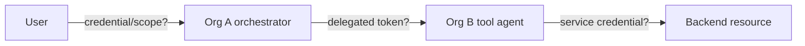

# Delegation chain

Last verified: 2026-09-05

| Hop | Issuer | Subject | Actor | Audience | Scope | Attenuated? | Revocable? | Audit link |
|---|---|---|---|---|---|---|---|---|
| User → orchestrator | | | | | | | | |
| Orchestrator → tool | | | | | | | | |
| Tool → backend | | | | | | | | |

